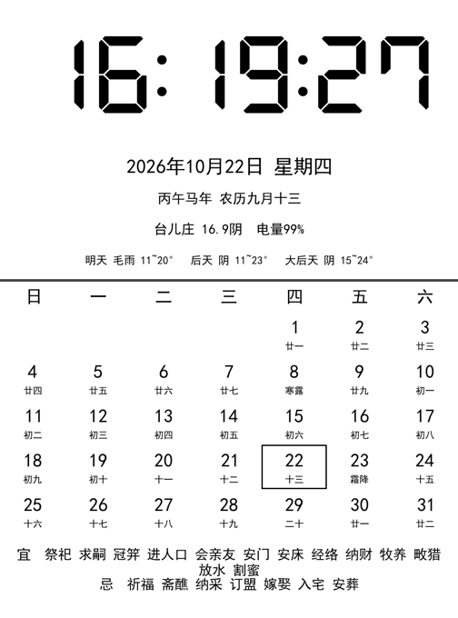

# kindle-clock

把一块触屏损坏（上半 1/3 失灵 + 幽灵触摸）的 **Kindle Paperwhite 4 (KPW4, 固件 5.18.1.1.1)** 改造成常驻电子墨水屏座钟。

不再当阅读器：开机即时钟，息屏保留画面，断网照常显示。



## 硬件与环境

- 设备：Kindle Paperwhite 4，固件 5.18.1.1.1
- root + USB 网络（RNDIS），PC 端 telnet `192.168.15.244:23`
- 屏幕渲染依赖 **KOReader** 自带的 `FBInk`（`/mnt/us/koreader/fbink`）直接写 framebuffer
- 触屏已坏，仅保留「电源键 + 时钟」用途

## 特性

- 数码管字体时间 `HH:MM:SS`（DSEG7 Classic Bold），精确居中
- 日期 / 星期 / 干支生肖年 / 农历月日
- 联网天气（Open-Meteo）：当前温度+天气 + 未来三天预报 + 电量百分比；**断网保留最后一次成功值**
- 月历：今日描边高亮，含农历日、节气、宜忌
- 开机自动进入时钟（upstart job `kindle_clock.conf`，无需手动拉起）
- 息屏后画面保留、不白屏；电源键短按 = 整屏重绘清残影
- 每天 03:00 自动 NTP 对时（防 RTC 长期走偏）
- 亮度固定 2 档（可在 `clock.conf` 改 `BRIGHT`）

## 原理

- 启动后 `stop framework`，由脚本接管屏幕，脱离 Kindle 原生 GUI
- 主循环每 1 秒：`draw_time_box` 用 DU 波形快刷时间区，分钟切换时整屏 GC16 清残影
- **天气走文件缓存 + 后台进程**：`/tmp/clock_wx.txt` 由后台循环每 10 分钟联网写入，画屏路径只 `read` 缓存、完全不碰网络——避免唤醒时因联网卡住而「先出时间、后出其他」
- 农历数据预生成到 2045 年底（见 `data/calendar_data.txt`），运行时用月份缓存只读当月 31 行，避免每次全文件扫描

## 文件结构

```
kindle_clock.sh      主脚本（设备端 /mnt/us/clock/）
kindle_clock.conf     upstart 自启 job（设备端 /etc/init/）
fonts/
  clock_font.ttf     子集化中文黑体（含农历/节气/宜忌用字）
  dseg_font.ttf      数码管字体 DSEG7（仅 0-9 与 :）
data/
  calendar_data.txt  农历/节气/宜忌数据集 2026-01-01 .. 2045-12-31
tools/
  gen_calendar.py    重新生成 data/calendar_data.txt（依赖 lunar-python）
  subset_font.py     重新子集化 fonts/（依赖 fonttools）
  deploy_clock2.py   通过 telnet 可靠推送文件到设备（大文件走 gzip）
  install_job.py     把 kindle_clock.conf 装到设备 /etc/init/
  cap_now.py         抓取当前 framebuffer 存为 PNG（PC 端校验用）
  kindle_telnet.py   telnet 执行单条命令
  restart_verify.py  重启时钟并验证运行状态
```

## 从零部署教程

### 0. 前置准备（本项目不含，需你先完成）

本脚本假设设备已经具备下面三件事，这部分的越狱步骤因固件版本而异，请按你的机型自行完成：

1. **越狱 + 拿到 root shell**：参考 MobileRead 论坛对应固件版本的 Kindle 越狱帖。
2. **开启 USB 网络（RNDIS）**：在 Kindle 上启用 USBnet，PC 端装好 RNDIS 驱动；插上 USB 后应能 `telnet 192.168.15.244 23` 进 root shell。
3. **安装 KOReader**：本脚本直接复用 KOReader 自带的 `FBInk`（`/mnt/us/koreader/fbink`），免去自己交叉编译 framebuffer 工具。

> 完成以上三步后，插 USB → 启用「USB 网络」，PC 端 `telnet 192.168.15.244 23` 能进 root 即表示环境就绪。

### 1. 克隆仓库

```bash
git clone https://github.com/Josetar2/kindle-clock.git
cd kindle-clock
```

### 2. 配置你的城市与亮度

编辑 `kindle_clock.conf`（或设备端自建 `/mnt/us/clock/clock.conf`），设置：

| 变量 | 含义 | 默认值 |
|---|---|---|
| `LAT` / `LON` | 经纬度，决定天气（Open-Meteo，无需 API key） | 台儿庄 |
| `CITY` | 屏幕上显示的城市名 | `台儿庄` |
| `BRIGHT` | 亮度档位 0–24 | `2` |

经纬度可在 open-meteo.com 或任意地图工具查到。

### 3. 推送到设备

确保 USB 网络已连、telnet 可达，然后：

```bash
python tools/deploy_clock2.py    # 推 kindle_clock.sh + 字体 + 20 年农历数据(gzip)
python tools/install_job.py      # 装自启 job 到 /etc/init 并 reload
```

- 大文件走 gzip，约 80s 推完，推完自动做 md5 校验。
- 若你的 telnet 地址不是 `192.168.15.244`，改 `tools/*.py` 里的 `HOST` 即可。

### 4. 开启开机自启开关

在 Kindle 的 `/mnt/us/clock/` 下建一个**空文件** `ENABLED`（U 盘模式或 telnet 里 `touch` 均可）：

```bash
# 通过 telnet 进设备后执行：
touch /mnt/us/clock/ENABLED
```

`ENABLED` 存在 = 开机进时钟；删掉它再重启 = 设备恢复正常 Kindle 界面。

### 5. 重启，进入纯时钟

```bash
# telnet 里重启（脚本已确保配置落盘）
reboot
```

重启后设备会自动：`stop framework` → 时钟接管屏幕 → 等 WiFi 对时 → 显示完整时钟界面（含开机弹窗二次覆盖，无需手动干预）。

### 6. 日常使用

- **电源键短按**：息屏（墨水屏保留最后一帧，几乎不耗电）/ 再按唤醒，并整屏重绘清残影。
- **改配置**：改 `clock.conf` 后跑 `python tools/restart_verify.py` 重启时钟生效。
- **关掉自启**：删 `/mnt/us/clock/ENABLED` 再重启，回到原生系统。
- **PC 端抓屏验证**：`python tools/cap_now.py && open clock_live.png`。

### 7. 故障排查

| 现象 | 处理 |
|---|---|
| 开机不进时钟 | 确认 `ENABLED` 存在；`initctl status kindle_clock`；看 `/tmp/clock_run.log` |
| 屏幕白 / 有残留弹窗 | 短按电源键整屏重绘，或 `python tools/restart_verify.py` |
| 天气一直旧值 / 不更新 | 查 WiFi；`curl` 能否访问 open-meteo；断网本就保留上一次成功值 |
| 农历 / 宜忌 2046 年起空白 | 改 `tools/gen_calendar.py` 的 `END` 重跑并重新部署 |
| telnet 连不上 | 确认 USB 网络已启用、IP 为 192.168.15.244 |

## 重新生成数据 / 字体

```bash
pip install lunar-python fonttools
python tools/gen_calendar.py      # 生成 data/calendar_data.txt
python tools/subset_font.py       # 生成 fonts/clock_font.ttf
```

> 默认数据到 2045-12-31；要撑更久改 `gen_calendar.py` 的 `END` 重跑即可（2046 年起农历/宜忌会空白）。

## 已知限制

- 农历数据有截止日期（2025→2045 共 20 年）
- 依赖 KOReader 的 FBInk；若未装 KOReader 需另寻 FBInk 二进制
- 自动对时与天气需要 WiFi；长期离线时间靠 RTC 走偏（每天几秒内），靠每天 03:00 联网纠正
- 锂电池长期插电供电，硬件层面建议偶尔留意鼓包

## License

MIT
